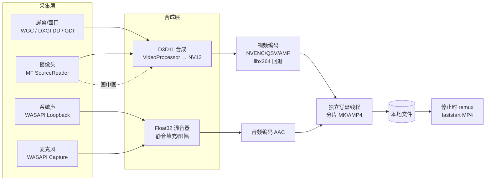

## 用户需求

为一款桌面录屏软件产出完整的产品方案文档，覆盖功能需求、系统架构、技术选型与版本里程碑四个层面。首版聚焦 Windows 桌面端，架构需为后续跨平台扩展预留空间。交付物为写入工作区的 Markdown 文档集，便于版本管理。

## 产品概述

一款面向 Windows 的本地优先录屏工具，支持屏幕、区域、窗口与摄像头画面采集，系统声音与麦克风混合录制，并提供参数可调的录制、轻量编辑与文件管理能力。核心体验目标是「一键开录、录制稳定、导出即用」，在长时间录制与低资源占用上表现可靠，同时以清晰的托盘/悬浮控件降低录制过程中的操作干扰。

## 核心功能

### 采集能力

- 全屏/指定显示器录制，多显示器独立选择，混合 DPI 缩放下画面不失真
- 自定义区域录制，支持拖拽选区和固定尺寸预设
- 单窗口录制，窗口移动/缩放时自动跟随，被遮挡时仍可正常采集
- 摄像头画中画，位置、大小、形状、层级可调，可镜像
- 系统声音与麦克风同时采集，支持混音为单轨或保留双轨、独立音量调节

### 录制控制

- 开始、暂停、恢复、停止完整状态控制，暂停时长不计入成片
- 可选倒计时开录，录制中显示时长与磁盘余量
- 全局快捷键开始/暂停/停止，支持自定义与冲突检测
- 托盘菜单与录制中悬浮工具条

### 画质与参数

- 分辨率、帧率、码率、输出格式可配置，提供画质预设档位
- 编码器自动探测与硬编优先、软编回退，兼顾画质与占用
- 录制前参数校验与效果预估提示

### 编辑与导出

- 时间轴裁剪、多段拼接、画面标注（箭头、矩形、文字、马赛克）
- 字幕叠加与导入、局部放大、鼠标点击动效
- 导出时可选分辨率/码率/格式，支持 GIF 与音频提取

### 文件管理

- 自定义保存路径、命名模板（时间、来源、序号等变量）、自动归档
- 录制结束后格式转换与压缩
- 文件列表管理：预览、重命名、删除、定位到目录
- 可选云端上传与分享链接

### 性能与稳定性

- 硬件编码路径下 CPU 占用可控，录制中不引起明显掉帧
- 长时间录制内存与磁盘写入平稳，支持自动分片
- 兼容 Windows 10 与 Windows 11、多显卡、多显示器、高刷新率场景

### 辅助功能

- 定时/计划录制，按时长或结束时间自动停止
- 鼠标高亮、点击涟漪、光标样式增强
- 自定义水印（文字/图片）、隐私遮挡区域

### 异常处理

- 断电或崩溃后录制文件可恢复播放
- 磁盘剩余空间阈值预警，预估可继续录制时长
- 编码器初始化失败、路径不可写、设备被占用等场景的降级与提示

## 交付物定位

工作区 `d:/develop/project/person/Screen Recording` 经确认为空目录，无既有代码与文档。本任务为纯 greenfield 文档编写，产出 1 篇索引 + 5 篇方案文档。文档中的技术结论必须自洽、可验证，不得伪造性能数据或引用不存在的实现。

## 推荐技术方案（需在 03 文档中给出对比论证）

### 目标平台与约束

- 主目标：Windows 10 1903+ 与 Windows 11，x64 为主、ARM64 为 V1.5 验证项
- 仅用户态实现，不依赖驱动；UAC 提升窗口采集需以管理员身份运行（文档需显式标注该限制）
- 采集层、编码层、UI 层之间保持接口抽象，为后续 macOS（ScreenCaptureKit）接入预留适配位

### 语言与 UI

- 核心引擎：C++20 + MSVC 2022 + CMake + vcpkg，直接与 COM/D3D11 互操作，避免跨语言封送开销
- UI：Qt 6 QML（LGPL），单进程 UI + 独立录制引擎进程；备选 WinUI3/WPF 需在文档中说明放弃理由（COM 互操作成本、GC 抖动、跨平台不可复用）

### 采集

- 主路径 WGC（Windows.Graphics.Capture）：D3D11 纹理直出，支持显示器与窗口、被遮挡窗口采集、光标开关
- 高性能/独占全屏补充路径 DXGI Desktop Duplication；老旧设备 GDI BitBlt 兜底（限帧）
- 窗口采集失败时回退 PrintWindow(PW_RENDERFULLCONTENT)
- 摄像头：Media Foundation SourceReader 输出到 D3D11 纹理参与合成
- HDR：帧池使用 R16G16B16A16_FLOAT，SDR 输出做色调映射（标注为需实机验证项）
- 受保护内容（DRM）采集为黑屏，作为已知限制写入文档

### 音频

- 系统声音：WASAPI Loopback（共享模式事件驱动，IAudioClient3 低延迟）；静音期无数据包必须主动填充静音样本以保持时间轴连续
- 麦克风：WASAPI Capture 独立流，设备热插拔需重建流并补齐时间戳
- 混音：自研 float32 混音器，支持双轨保留与单轨混音两种输出模式，独立增益与限幅
- 同步：以 QPC 单调时钟为基准，音频样本计数推导主时钟，视频 PTS 做漂移补偿

### 编码与封装

- 硬编：NVENC / Intel oneVPL(QSV) / AMD AMF，运行时能力探测（分辨率、帧率、码率上限）
- 软编：libx264 回退；音频 AAC（Media Foundation AAC MFT 或 libavcodec native aac，避免 fdk-aac 许可问题）
- 色彩转换与缩放：D3D11 VideoProcessor 在 GPU 完成 RGB→NV12，禁止 CPU 回读
- 录制中写分片 MKV（抗崩溃），停止时 remux 为 faststart MP4；封装统一走 libavformat

### 进程与通信

- UI 进程（Qt）与 Recorder 进程（无窗口录制引擎）分离，命名管道传控制指令，D3D11 共享纹理（NT handle）实现零拷贝预览
- 录制引擎崩溃不拖垮 UI，UI 可触发中断文件修复流程

## 文档集实现策略

### 需求编号与标签规则

- 编号：`M{模块号}-{两位序号}`，如 `M1-03`；模块固定为 M1 采集、M2 录制控制、M3 画质参数、M4 编辑、M5 文件管理、M6 性能兼容、M7 辅助、M8 异常
- 每条需求包含：编号 / 需求描述 / 验收要点（可测判据）/ 版本标签（V1.0 | V1.5 | V2.0）
- 需求用表格承载，禁止出现无验收要点的条目

### 各文档强制结构

1. `README.md`：方案定位、文档索引与阅读顺序、编号规则、版本标签定义、术语表
2. `01-功能需求清单.md`：8 模块需求表格 + 模块级汇总（条目数 / 各版本分布）+ 需求追踪矩阵
3. `02-系统架构.md`：分层与进程模型、线程模型与队列背压、采集→合成→编码→封装数据流、录制状态机、时间戳与同步策略、模块职责边界
4. `03-技术选型.md`：按采集/音频/编码/封装/UI/语言六个维度做候选对比表（能力、许可、风险、结论）+ 关键风险与验证清单
5. `04-里程碑与排期.md`：V1.0/V1.5/V2.0 范围映射到需求编号、依赖关系、交付判据、风险清单
6. `05-非功能需求与验收.md`：性能基线（CPU/内存/首帧延迟/写盘）、兼容性矩阵（系统版本、DPI、多显示器、混合显卡、高刷、ARM64）、长录制稳定性、异常恢复验收用例

## 系统架构



队列策略：各级之间使用有界帧队列，超限按策略丢帧并保留 PTS 空洞，禁止阻塞采集线程；写盘线程独立，fsync 节流，避免 I/O 抖动反压到编码。

## 目录结构

```
Screen Recording/
├── README.md                      # [NEW] 方案索引。含产品定位、文档阅读顺序、需求编号与版本标签规则、术语表（WGC/WASAPI/remux/PiP 等）
└── docs/
    ├── 01-功能需求清单.md          # [NEW] 8 大模块需求表格（编号/描述/验收要点/版本标签）+ 模块汇总 + 需求追踪矩阵。须覆盖多显示器、混合 DPI、独占全屏、DRM 黑屏、静音期音频填充、双轨与混音、热键冲突、暂停不计时长、命名模板、FAT32 4GB、8 小时长录制、断电恢复等边界
    ├── 02-系统架构.md              # [NEW] 分层与双进程模型、线程与有界队列背压、采集到封装的完整数据流、录制状态机（Idle→Countdown→Recording→Paused→Stopping→Recovering）、QPC 时钟与音视频同步、模块职责边界与接口契约
    ├── 03-技术选型.md              # [NEW] 六维度候选对比与推荐结论、许可与分发约束（Qt LGPL、AAC 专利、NVENC/oneVPL/AMF SDK）、硬件能力探测与降级矩阵、风险与验证清单
    ├── 04-里程碑与排期.md          # [NEW] V1.0 MVP / V1.5 增强 / V2.0 进阶三阶段范围映射到需求编号、阶段依赖关系、交付判据、风险与缓解措施
    └── 05-非功能需求与验收.md      # [NEW] 性能基线与测量方法、兼容性矩阵、长录制稳定性判据、异常与恢复验收用例（断电、崩溃、磁盘满、编码器失败、设备占用、路径无权限）
```

## 实施要点

- 六篇文档共用同一套编号与标签口径，01 文档的每条需求必须在 04 中找到唯一版本归属，在 05 或验收要点中找到可测判据
- 性能指标以「基线 + 测量方法 + 达成条件」表述，不写未经实测的绝对数值承诺；参考区间标注为设计目标
- 边界场景必须成条列出：静音期 loopback 无包、麦克风热插拔、HDR、独占全屏、DRM 黑屏、UAC 提升窗口、多显示器混合 DPI、写盘拥塞、编码器初始化失败
- 文档为纯描述性产物，不创建工程骨架、不引入构建配置，避免超出「需求与方案」的交付边界