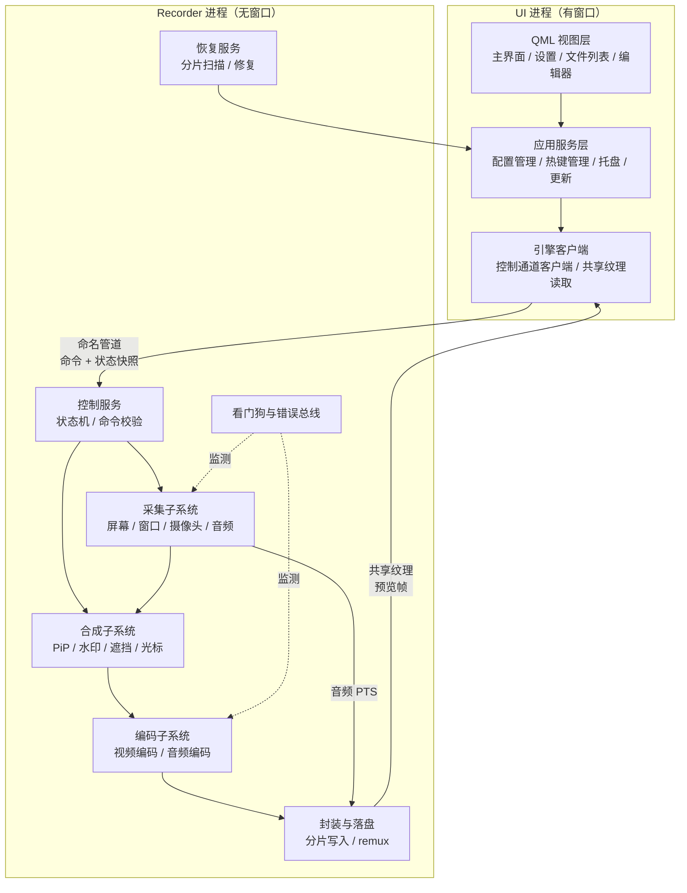
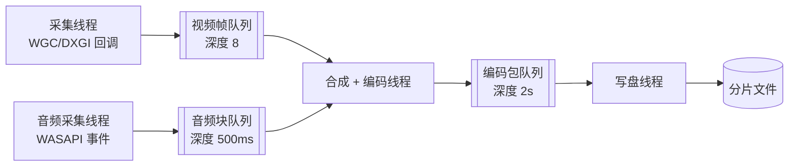
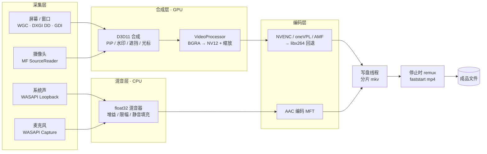
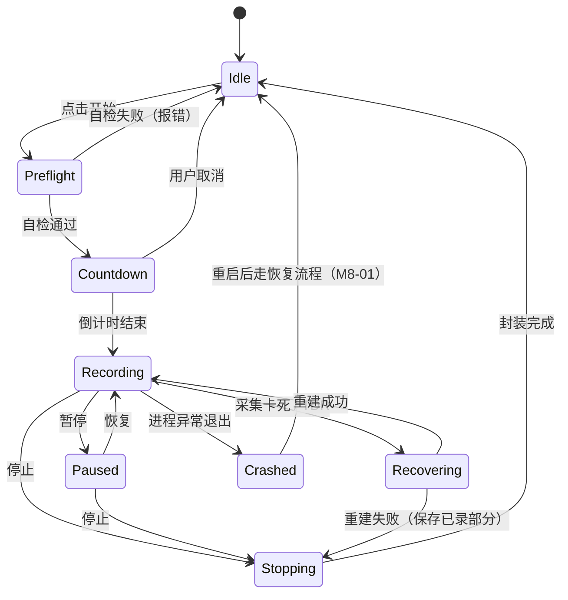

# 02 · 系统架构

> 承载 [01-功能需求清单](./01-功能需求清单.md) 中全部 144 条需求的实现骨架。本文只描述**职责边界、数据流、线程与同步**，具体技术产品选择见 [03-技术选型](./03-技术选型.md)。

## 1. 架构原则

| 原则 | 落地方式 | 对应需求 |
| --- | --- | --- |
| **稳定性优先于功能性** | 录制引擎独立进程，崩溃不拖垮 UI；录制中写分片而非单一长文件 | M8-01、M8-02 |
| **零拷贝优先** | 采集纹理全程留在 GPU，仅编码器需要 CPU 时才回读 | M6-01、M6-02 |
| **采集线程永不阻塞** | 采集回调内不允许任何 I/O、锁等待、内存分配（预分配纹理池） | M6-03、M3-15 |
| **时间基准单一** | 全链路只用 QPC 一个时钟，音频样本计数作为主时钟校准 | M1-21、M6-09 |
| **平台可替换** | 采集层、编码层、封装层各自接口化，平台差异收敛在实现类内 | M6-13 |
| **状态机驱动 UI** | UI 不自己推断状态，全部由引擎上报的状态机快照渲染 | M2-10 |

## 2. 分层与进程模型



文字说明（图渲染失败时）：**UI 进程**负责界面、配置、热键与文件管理；**Recorder 进程**是纯命令行启动的无窗口引擎，负责采集、合成、编码、落盘；两者通过**命名管道**传递控制命令与状态快照，通过**D3D11 共享纹理**传递预览帧。

### 2.1 为什么要双进程

| 风险场景 | 单进程后果 | 双进程后果 |
| --- | --- | --- |
| 编码器驱动层崩溃（NVENC/AMF 均有先例） | 整个应用消失，正在写入的文件句柄强关，文件可能损坏 | 只有 Recorder 崩溃，UI 存活并立刻捕获到管道断开，触发 M8-01 恢复流程 |
| UI 侧 GC / 布局抖动 | 直接反映为录制掉帧 | UI 卡顿不影响采集线程 |
| 用户误关闭主窗口 | 录制被终止 | 可让主窗口关闭后 Recorder 继续录制（M2-13） |

代价：多一次进程启动开销（约 100~200ms）与一套 IPC 协议。这笔开销在「开始录制」这种低频动作上可接受。

### 2.2 进程生命周期

- UI 启动时**不**预启动 Recorder（省内存），首次录制时拉起，空闲 5 分钟后自动退出。
- Recorder 以 `--session <token>` 启动，token 由 UI 生成写入共享内存，防止第三方进程伪造录制指令。
- Recorder 退出码区分正常停止（0）、异常（非 0）；UI 据此决定是否走恢复流程。

## 3. 线程模型与背压



| 线程 | 职责 | 实时性要求 | 阻塞来源与对策 |
| --- | --- | --- | --- |
| 采集线程 | 从 WGC/DXGI 取帧，校验时间戳，投递到帧队列 | **硬实时**：单次处理 ≤ 4ms | 不可阻塞。帧队列满则立即丢弃本帧（记丢帧计数），绝不等待 |
| 音频采集线程 | WASAPI 事件驱动取包，做格式转换后投递 | 硬实时：单次 ≤ 2ms | 队列满时不做丢弃，改为扩大混音批次（一次取两倍样本） |
| 合成 + 编码线程 | 取帧 → 合成 → 转 NV12 → 送编码器 → 收包 | 软实时 | 编码器忙时阻塞在此线程，反压回帧队列，最终由采集线程丢帧吸收 |
| 写盘线程 | 收编码包 → 写分片 → 按需 fsync | 无实时性 | 磁盘慢时包队列积压，触发 M8-13 背压策略 |
| 控制线程 | 管道收发命令、状态快照推送 | 无实时性 | 每 500ms 推送一次状态，UI 侧不轮询 |
| 看门狗线程 | 检测采集回调是否停止、队列是否长期为空 | 无实时性 | 超时触发采集源重建（M8-17） |

### 3.1 背压策略（从下游到上游逐级生效）

1. **包队列积压**（写盘慢）→ 降低视频编码码率（一次性），延后关键帧，最坏情况丢非关键帧包。
2. **帧队列积压**（编码慢）→ 采集侧按「时间戳间隔丢弃」策略丢帧，保证时间轴仍匀速（M3-15）。
3. **音频永不丢**：音频数据量小（48kHz 立体声 float ≈ 384KB/s），丢音频必然导致音画不同步，因此宁可让视频丢帧。
4. 任何一级触发背压都要**记事件**并在 M6-11 面板上可见，不允许静默降质。

## 4. 录制管线数据流



### 4.1 各环节关键约束

| 环节 | 关键约束 | 违反后果 |
| --- | --- | --- |
| 采集 → 合成 | WGC 提供的纹理必须在 `Close()` 前用完，不能跨帧持有 | 帧池耗尽，系统暂停投帧，表现为录制卡死 |
| 合成 → 转 NV12 | 画布尺寸必须偶数，且与编码器对齐要求一致（部分硬编要求 16 对齐） | 编码器初始化失败或边缘花屏 |
| 音频混音 | 两路输入必须各自补齐到等长样本才能相加，缺包一律填 0 | 音画不同步、总时长偏短（M1-21） |
| 编码 → 封装 | 视频包与音频包必须按 DTS 单调写入；B 帧需重排 | 播放器花屏、时长异常 |
| 落盘 | 分片边界必须落在关键帧 | 分片独立播放时开头花屏 |

### 4.2 光标的两条路径（重要取舍）

WGC 原生支持把光标画进纹理（`IsCursorCaptureEnabled`），代价是**无法修改光标外观**。而 M7-04（光标放大/聚光灯）与 M7-05（点击涟漪）都需要自绘。

因此：

- 关闭光标增强时 → **用 WGC 原生光标**（零成本，指针延迟最低）。
- 开启光标增强时 → **关闭原生光标**，改由合成层自绘：单独一路低分辨率光标纹理合成到画布上。
- 自绘光标会引入 1 帧左右的指针延迟，作为已知取舍在设置页说明。

这一条同时解释了为什么 M1-24（光标开关）在 V1.0，而 M7-04/M7-05 在 V1.5 —— 后者需要新的自绘链路。

## 5. 录制状态机



状态机规则：

1. **单一所有权**：状态只存在于 Recorder 进程，UI 看到的是快照。UI 的按钮禁用状态由快照推导，不做本地乐观更新。
2. **命令幂等**：重复 Start/Pause 命令不产生副作用，返回当前状态而非报错。
3. **Preflight 独立成态**：自检（M2-14）必须是一个可观测状态，否则用户点击后 500ms 无反馈会被误判为卡死。
4. **Paused 不等于 Stopping**：暂停时采集资源**保留**（避免恢复时重建导致 1~2s 空洞），但停止投递帧，因此不占带宽、不写盘。
   > 与 01 的 M2 设计取舍注释（「暂停采用停止采集 + 断点续写」）冲突。2026-10-21 裁定**按 01 执行**：
   > 暂停时真正 Stop 采集源与音频源，避免暂停期间占用 GPU 与磁盘带宽；恢复时重建，
   > 首帧等待超过 50ms 的部分用复制上一帧补齐（≤3 帧）。依据见 08 §14.3。
5. **进入 Stopping 后不可取消**：封装与 remux 是原子动作，中途取消会留下损坏文件。

## 6. 时间戳与音视频同步

### 6.1 时钟选择

| 候选 | 优势 | 问题 | 结论 |
| --- | --- | --- | --- |
| 系统墙钟（`GetSystemTime`） | 直观 | 受 NTP 校时与手动改时间影响，会跳变 | 禁用 |
| `timeGetTime` | 简单 | 精度 1ms，受系统节流影响 | 禁用 |
| **QPC** | 高精度、单调、不受校时影响 | 无绝对时间语义 | **采用**，作为唯一时间源 |

### 6.2 主时钟

**音频为主时钟**：以已写入封装的音频样本数除以采样率得到 `audio_clock`。

理由：音频是连续流，采样率固定，样本数天然单调；视频是离散帧，天然允许丢帧补偿。反过来（视频为主时钟）意味着音频需要重采样或插入/删除样本，会引入可闻的杂音。

### 6.3 视频 PTS 生成与漂移补偿

```
v_pts_raw   = QPC_now - QPC_session_start          // 采集时刻
v_pts       = v_pts_raw + user_offset_ms           // M1-23 手动校准偏移
drift       = v_pts - audio_clock
```

| drift 区间 | 处理 |
| --- | --- |
| `|drift| ≤ 100ms` | 正常，直接写入 |
| `100ms < drift ≤ 500ms` | 连续丢帧（跳过若干帧）追赶，丢帧计数 +1 |
| `drift > 500ms` | 判定为采集阻塞，丢弃当前帧并重建采集源（走 M8-17 看门狗） |
| `-500ms ≤ drift < -100ms` | 复制上一帧补齐（画面静止，但时间轴连续） |
| `drift < -500ms` | 判定为音频时钟异常，以视频时钟为准重设音频基准并记日志 |

### 6.4 无音频场景

用户关闭所有音频源时，主时钟退化为 **QPC 直接驱动**，此时视频 PTS 完全由 QPC 决定，不需要漂移补偿 —— 但采样率式的均帧处理仍然执行，保证输出帧率均匀。

### 6.5 8 小时不漂移的验证方式（对应 M6-09）

在成片的第 1 分钟、第 4 小时、第 8 小时各插入一次「拍手 + 秒表同时可见」的基准动作，逐点检查声画偏差 ≤ 100ms。这是 05 文档 §4 的验收用例之一。

## 7. 模块职责与接口契约

接口以职责描述表达，不绑定具体签名。

| 模块 | 职责 | 输入 | 输出 | 明确**不**做的事 |
| --- | --- | --- | --- | --- |
| `ICaptureSource` | 产出带 QPC 时间戳的屏幕/窗口纹理 | 源描述（显示器 ID / 窗口句柄 / 区域矩形） | 纹理 + PTS | 不做缩放、不做色彩转换 |
| `ICameraSource` | 产出摄像头帧纹理 | 设备 ID、请求格式 | 纹理 + PTS | 不做 PiP 布局 |
| `IAudioSource` | 产出 float32 交错样本块 | 设备 ID、采样参数 | 样本块 + 样本计数 | 不做混音、不做编码 |
| `ICompositor` | 把多路纹理合成为一张画布 | 主画面、PiP、水印、遮挡、光标 | 合成后画布纹理 | 不做色彩转换（交给 VideoProcessor） |
| `IAudioMixer` | 多路混音、增益、限幅、静音填充 | 多路样本块 | 单轨或多轨样本 | 不做重采样以外的处理 |
| `IVideoEncoder` | 纹理进、编码包出 | NV12 纹理 + PTS | 编码包 + DTS/PTS | 不做封装、不做丢帧决策 |
| `IAudioEncoder` | 样本进、编码包出 | 样本块 | 编码包 | 不做混音 |
| `IMuxer` | 按 DTS 写包、切分片、收尾 | 视频/音频包 | 分片文件 | 不做 remux（由 `IRecoveryService` 承担） |
| `IControlServer` | 命令解析、状态快照推送 | 管道消息 | 状态快照、错误事件 | 不直接操作采集/编码对象（经状态机） |
| `IRecoveryService` | 扫描分片、探测可播性、remux 修复 | 分片路径 | 成品文件 / 恢复报告 | 不做重编码 |

### 7.1 错误总线

引擎内所有错误统一走一条事件总线，携带 `code / severity / module / recoverable / userMessage`。

- `severity = Fatal` → 走 Stopping 流程，保存已录内容后退出录制态。
- `severity = Recoverable` → 尝试自动恢复（重建资源/降级编码器），并向 UI 推送 toast。
- `severity = Warn` → 仅记日志 + 面板标记（如丢帧、背压）。

**不允许任何模块直接弹窗或静默吞掉异常**，这是 M8 全模块可验收的前提。

## 8. 关键设计决策（ADR）

| 编号 | 决策 | 备选方案 | 理由 | 代价 |
| --- | --- | --- | --- | --- |
| ADR-01 | 双进程 | 单进程 + 线程隔离 | 驱动级崩溃无法用线程隔离兜住 | 多一套 IPC 与进程生命周期管理 |
| ADR-02 | 录制中写分片 MKV，停止时 remux 为 MP4 | 直接写 MP4 | 崩溃时 MP4 的 moov 未写导致整文件不可用；MKV 天然容错 | 停止时多一次 remux（约 1~3s/小时素材） |
| ADR-03 | 音频为主时钟 | 视频为主时钟 / QPC 为主时钟 | 音频重采样的音质损失不可接受 | 需要静音填充逻辑（M1-21） |
| ADR-04 | 合成层自绘光标（仅增强模式） | 全程自绘 / 全程原生 | 兼顾低延迟与增强能力 | 两条光标路径需分别测试 |
| ADR-05 | 合成与转换在 GPU 完成 | CPU 回读 + libswscale | 4K 场景下 CPU 回读会成为瓶颈 | 硬编必须支持 D3D11 输入，老设备走回退 |
| ADR-06 | 界面层用 QML | WinUI3 / WPF | 与 C++ 引擎互操作成本低，且为跨平台预留 | 需处理 Qt 与 D3D 的纹理互操作 |
| ADR-07 | 水印/遮挡在录制时固化 | 录制后叠加 | 避免「录完才想起要打码」的场景被误认为已保护 | 不可撤销，需在设置页明确提示 |

## 9. 与需求的对应关系

| 需求簇 | 架构承载点 |
| --- | --- |
| M1 采集类 | §4 采集层 + §4.2 光标双路径 |
| M2 控制类 | §5 状态机 + §3 控制线程 |
| M3 参数类 | §4.1 编码约束 + §7 `IVideoEncoder` 能力查询 |
| M4 编辑类 | 复用 `IVideoEncoder` / `IMuxer` / `IAudioMixer`，新增编辑引擎（V1.5 展开） |
| M5 文件类 | §7 `IMuxer` + `IRecoveryService` + UI 侧文件服务 |
| M6 性能类 | §3 背压 + §4 零拷贝 + §6 时钟 |
| M7 辅助类 | §4 合成层 + 调度器（定时录制独立于录制管线） |
| M8 异常类 | §5 Recovering 态 + §7.1 错误总线 + `IRecoveryService` |
