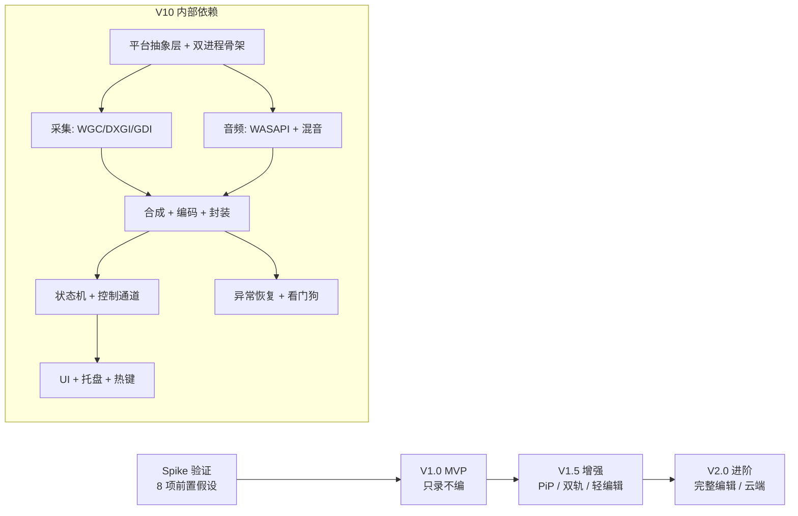

# 04 · 里程碑与排期

> 排期以**阶段**表达而非日历日期：具体周期取决于团队规模，而阶段之间的依赖关系与每阶段的**退出判据**是稳定的。

> **⚠ 本文为初始规划。** 执行过程中出现的环境约束（无 FFmpeg 开发包、无厂商编码 SDK、
> 一度无 Windows SDK）已导致技术路线调整，实际进度与门定义见
> [08-阶段重排与任务清单](./08-阶段重排与任务清单.md)。两文冲突时，**以 08 为准**。

## 1. 排期原则

| 原则 | 说明 |
| --- | --- |
| **录制可靠性优先于功能广度** | V1.0 不含任何编辑能力，把预算全部投向「录得下来、存得完整、放得出来」 |
| **架构债前置偿还** | M6-13（平台抽象层）必须在 V1.0 落地。一旦采集/编码写进 UI 逻辑，V1.5 的重构成本会翻三倍 |
| **先验证 Spike，再排实现** | [03 文档 §11](./03-技术选型.md#11-风险与验证清单spike-任务) 的 8 个 Spike 全部完成前，V1.0 的实现排期只做粗粒度估算 |
| **每个阶段可独立交付** | 三个版本都是完整可发布的产品形态，不存在「用到一半」的中间态 |
| **需求不跨版本** | 一条需求的实现与验收必须落在同一版本内完成 |

## 2. 三阶段范围

### 2.1 V1.0 · MVP（66 条）

**一句话定位**：能稳定录制全屏/区域/窗口，带系统声与麦克风，停止即得到一个能双击播放的 MP4。

| 模块 | 纳入需求 | 数量 |
| --- | --- | ---: |
| M1 采集 | M1-01、02、04、05、07、08、09、15、17、18、20、21、24、27 | 14 |
| M2 控制 | M2-01、02、03、04、05、06、07、08、09、10、12、13、14、16 | 14 |
| M3 参数 | M3-01、02、03、04、05、06、07、09、10、12、15 | 11 |
| M4 编辑 | —（本版本不做编辑） | 0 |
| M5 文件 | M5-01、02、04、06、07、15 | 6 |
| M6 性能 | M6-01、02、03、04、05、06、08、09、10、11、13 | 11 |
| M7 辅助 | M7-13 | 1 |
| M8 异常 | M8-01、02、03、04、05、06、07、08、14 | 9 |
| | **合计** | **66** |

**V1.0 刻意不做的事及理由**：

| 未纳入 | 理由 |
| --- | --- |
| 摄像头画中画（M1-11~14） | 引入第二路采集源与合成复杂度，与「先保证单路采集稳定」相冲突 |
| 双轨音频（M1-19） | 混音单轨已覆盖 90% 使用场景，双轨是剪辑用户的诉求，随编辑一起上 |
| H.264 之外的编码格式 | 多一种编码就多一套兼容矩阵，MVP 阶段收益低于成本 |
| 编辑、水印、鼠标高亮 | 对「录制成功率」零贡献 |
| 定时录制 | 依赖进程常驻与调度器，属稳定性风险项，V1.5 引入 |

**V1.0 退出判据**：见 [05 文档 §7.2](./05-非功能需求与验收.md#72-版本准入门槛) 的六条门槛。

### 2.2 V1.5 · 增强（48 条）

**一句话定位**：补齐专业录屏场景 —— 画中画、双轨、长时间自动化、画面增强与轻量剪辑。

| 模块 | 纳入需求 | 数量 |
| --- | --- | ---: |
| M1 采集 | M1-06、10、11、12、13、14、16、19、23、25、28 | 11 |
| M2 控制 | M2-11 | 1 |
| M3 参数 | M3-08、11、13、14 | 4 |
| M4 编辑 | M4-01、02、04、05、06、09、13、14 | 8 |
| M5 文件 | M5-03、05、08、09、10 | 5 |
| M6 性能 | M6-07、12、17 | 3 |
| M7 辅助 | M7-01、02、04、05、06、07、09、12 | 8 |
| M8 异常 | M8-09、10、11、12、13、15、17、18 | 8 |
| | **合计** | **48** |

**本阶段的核心难点（按风险排序）**：

1. **M7-04/05 光标增强**：需要新增「自绘光标」链路（见 [02 文档 §4.2](./02-系统架构.md#42-光标的两条路径重要取舍)），是全阶段唯一需要改建采集链路的改动。
2. **M8-09 TDR 恢复**：GPU 复位后重建 D3D 设备意味着所有纹理、编码器实例全部失效，恢复逻辑必须与状态机的 Recovering 态严格对应。
3. **M4 编辑引擎**：时间轴模型 + 预览渲染 + 导出管线三件套，工作量约等于半个 V1.0。
4. **M1-19 双轨**：容器从单音轨变双音轨，会影响 M3-12 参数面板、M4 时间轴、M5-08 播放器的完整链路。

### 2.3 V2.0 · 进阶（30 条）

**一句话定位**：从「录屏工具」扩展为「录制 + 产出」的工作流工具。

| 模块 | 纳入需求 | 数量 |
| --- | --- | ---: |
| M1 采集 | M1-03、22、26 | 3 |
| M2 控制 | M2-15 | 1 |
| M3 参数 | M3-16、17、18 | 3 |
| M4 编辑 | M4-03、07、08、10、11、12、15、16、17、18 | 10 |
| M5 文件 | M5-11、12、13、14 | 4 |
| M6 性能 | M6-14、15、16 | 3 |
| M7 辅助 | M7-03、08、10、11、14 | 5 |
| M8 异常 | M8-16 | 1 |
| | **合计** | **30** |

**本阶段的取舍**：

- V2.0 的预算一半以上投在 **M4 编辑**（10 条），因为 V1.5 的编辑器只是「能用」，真正的竞争力在字幕、变速、局部放大这些「把录屏变成内容」的能力。
- **M5-13 云端上传**看似重要，实际只占 1 条 —— 它属于集成工作而非核心能力，且本地优先的定位决定了它不应成为主线。
- **M1-26 HDR** 与 **M3-16 10bit** 应捆绑交付，单独做任何一个都没有意义。

## 3. 阶段依赖关系

**硬依赖（不能并行）**：

| 前置 | 后续 | 原因 |
| --- | --- | --- |
| 平台抽象层（M6-13） | 所有采集实现 | 接口不定，实现会被 UI 逻辑污染 |
| 分片写入机制 | M2-11 分片、M8-01 恢复 | 同一套机制，先有再谈策略 |
| 状态机 | UI 的所有控制按钮 | UI 只渲染快照，状态机不定则 UI 无法开发 |
| 混音器（float32） | 双轨（M1-19）、音频编辑（M4-12） | 双轨是混音器的输出模式之一 |
| 编辑引擎时间轴模型 | 预览、导出、字幕、变速 | 所有编辑能力的公共底座 |

**可并行**：

- 采集链路 与 音频链路（仅共享时间戳约定）
- UI 框架搭建 与 引擎开发（通过 IPC 协议解耦，可先做假数据联调）
- 兼容性测试环境搭建 与 功能开发（提前铺机型）

## 4. 工作量估算

估算单位：**人周**，含开发与自测，不含测试团队的系统测试。经验区间 ±40%。

| 工作流 | V1.0 | V1.5 | V2.0 | 说明 |
| --- | ---: | ---: | ---: | --- |
| 平台抽象层 + 进程骨架 + IPC | 6 | 2 | 1 | V1.0 最重的基建 |
| 采集（屏幕/窗口/兜底） | 9 | 4 | 3 | 三种采集路径的适配与调试 |
| 音频（采集 + 混音 + 同步） | 6 | 3 | 3 | 时钟与静音填充是最难调试的部分 |
| 合成 + 编码 + 封装 | 8 | 4 | 4 | 三家硬编 + 软编回退 + remux |
| 录制控制 + 状态机 | 3 | 1 | 1 | |
| UI（主界面/设置/托盘/文件列表） | 7 | 4 | 4 | |
| 文件管理 | 2 | 3 | 4 | |
| 异常恢复 + 诊断 | 4 | 5 | 2 | V1.5 的 TDR 恢复很贵 |
| 编辑引擎 | 0 | 9 | 12 | |
| 画面增强（PiP/水印/遮挡/光标） | 0 | 7 | 4 | |
| 调度器（定时/计划） | 0 | 2 | 2 | |
| 云端上传 | 0 | 0 | 3 | |
| **小计** | **45** | **44** | **40** | |

配套成本（不在上表）：

- **兼容性测试矩阵执行**：V1.0 约 4 人周，V1.5 约 6 人周（机型组合增加）。
- **Spike 验证**：合计 2~3 人周，必须在 V1.0 启动前完成。
- **许可与法务确认**（H.264/HEVC 专利、LGPL 合规）：不是工程工时，但属于**发布前阻塞项**，需尽早启动。

按 3 人工程团队（1 采集/编码方向、1 UI/应用方向、1 全栈补位）估算，V1.0 约 4 个月（含测试缓冲），V1.5 约 4 个月，V2.0 约 4 个月。

> 估算的可信度声明：这是**基于方案范围的相对估算**，未经历史数据校准。真实排期必须在 Spike 完成后重估一次，尤其是采集与编码两条链路 —— 它们的实际成本高度依赖目标机群的硬件分布。

## 5. 风险清单

| 编号 | 风险 | 影响 | 概率 | 缓解措施 |
| --- | --- | --- | --- | --- |
| R-01 | WGC 在部分应用（GPU 渲染的 UWP、Chromium 硬解窗口）采集到黑帧 | 窗口录制不可用，核心卖点受损 | 中 | S-01 Spike 提前验证；准备 PrintWindow 取证路径；产品上标注「个别应用不支持」 |
| R-02 | H.264 / HEVC 专利许可成本高于预期 | 影响定价模型甚至商业模式 | 中 | 立项即启动法务确认；准备 AV1 作为免专利替代路线（M3-17） |
| R-03 | 硬编在目标机群覆盖率不足（老 Intel 核显、虚拟机） | 软编成为主路径，性能目标落空 | 中高 | A 机专门以软编口径设目标；S-07 验证 MF 软编实时性 |
| R-04 | 混合 DPI 坐标换算在极端组合下出错 | 区域录制错位，用户第一眼就发现 | 中 | S-02 Spike；建立 DPI 组合的自动化截图比对用例 |
| R-05 | 断电恢复成功率达不到「≤10s 内容丢失」 | 核心可靠性承诺打折 | 中 | S-05 Spike；用缩短分片时长换取恢复率；必要时修改需求并公示 |
| R-06 | 8 小时音频累积漂移 | 长录制场景口碑崩塌 | 低中 | S-04 Spike；引入周期性重采样校正作为兜底 |
| R-07 | 编辑引擎低估（V1.5 的 9 人周偏乐观） | V1.5 延期 | 高 | 编辑能力分批交付：先裁剪+拼接，再标注+字幕；允许拆出 V1.6 |
| R-08 | Qt LGPL 合规疏漏（误用静态链接或 GPL 模块） | 法律风险，需返工重发 | 低 | CI 增加依赖许可白名单检查；发版检查清单包含许可项 |
| R-09 | 杀软误报（录屏行为 + 全局钩子易被判定为恶意） | 安装与运行受阻 | 中 | 提前做多引擎扫描；热键使用 `RegisterHotKey` 而非键盘钩子，降低误报面 |
| R-10 | 竞品以「零配置一键录制」占据用户心智 | 功能对比不占优 | 中 | 差异化押在可靠性与长录制，不与人拼功能数量 |

## 6. 版本演进逻辑

三阶段的划分不是简单的时间切片，而是一条**能力累积曲线**：

1. **V1.0 解决「能不能用」** —— 所有投入都是为了「录制成功」这一件事。此阶段的任何功能扩张都会摊薄可靠性投入。
2. **V1.5 解决「够不够用」** —— 专业用户真正会抱怨的是「没有画中画」「不能双轨」「录 3 小时要手动停」，这些都在 V1.5 一次性补齐。
3. **V2.0 解决「值不值得付费」** —— 编辑、字幕、云端是把「工具」变成「工作流」的部分，也是唯一能拉开付费意愿的差异化。

因此，**任何 V1.0 阶段的功能插入请求，都应先回答一个问题：它会让「8 小时录制不崩」这件事变简单还是变复杂？** 答案通常是后者。
