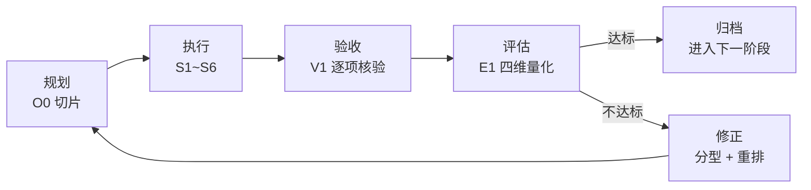
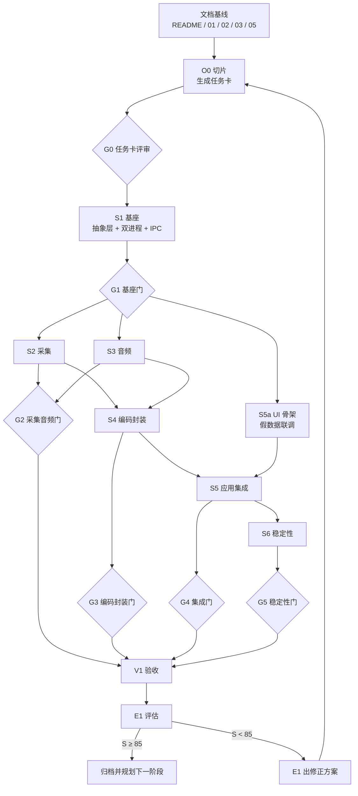

# 06 · 子智能体执行规程

> 定义「由子智能体依据本项目的 5 篇文档执行任务」的完整运行规则：**分工 → 顺序 → 输入输出 → 验收 → 评估 → 修正 → 重规划**。
> 本文是过程规范，不产生任何功能需求；所有功能判据一律回溯到 [01](./01-功能需求清单.md) 与 [05](./05-非功能需求与验收.md)。

## 1. 总则

### 1.1 三条不可让渡的原则

| 原则 | 含义 | 违反后果 |
| --- | --- | --- |
| **文档是唯一事实源** | 子智能体的所有产出必须能映射到具体需求编号；文档没写的需求不实现，文档写了的需求不可跳过 | 实现与需求脱节，验收无从判定 |
| **执行者不自证** | 写代码的智能体不得验收自己的产出；V1 独立核验 | 自证必然宽松，闭环失效 |
| **证据先于结论** | 任何「通过」必须附可复现的证据（命令 + 输出 + 时间戳），无证据即视为未通过 | 验收退化为口头承诺 |

### 1.2 闭环模型



闭环的**最小周期是一个阶段门（Gate）**，不是一次提交。理由：单次提交的样本量太小，量化评估会退化为噪声。

---

## 2. 角色与职责分工

| ID | 角色 | 负责需求（01 文档） | 负责文件域（唯一可写） | 明确禁止 |
| --- | --- | --- | --- | --- |
| **O0** | 编排者 | 全部（只做切片，不改代码） | `tasks/`、`docs/07-执行台账.md`、`CMakeLists.txt`、`vcpkg.json`、`CONTRACT.md` | 不写功能代码、不代替 V1 判定 |
| **S1** | 基座工程师 | M6-13、M2-10、M2-12、M2-14 | `src/core/`、`src/ipc/`、`src/platform/`、`src/recorder/`、`src/tools/` | 不实现采集/编码细节，只定义接口 |
| **S2** | 采集工程师 | M1-01~10、M1-24、M1-27、M6-06 | `src/capture/`、`src/compositor/` | 不碰音频与封装；不改 `src/core/` 接口（需走契约变更） |
| **S3** | 音频工程师 | M1-15~23、M3-12 | `src/audio/` | 不碰视频链路 |
| **S4** | 编码封装工程师 | M3-01~11、M3-15、M5-04、M5-15、M8-02 | `src/encode/`、`src/mux/` | 不做采集与 UI |
| **S5** | 应用界面工程师 | M2-01~09、M2-13、M2-16、M5-01~03、M5-06~07、M7-13、M4-*（V1.5 起） | `src/app/`、`ui/` | 不直接操作采集/编码对象，只能经控制通道 |
| **S6** | 稳定性工程师 | M8-01、M8-03~08、M8-14、M6-01~04、M6-11 | `src/resilience/`、`src/diag/` | 不修改业务逻辑，只加观测、恢复与背压 |
| **V1** | 验收官 | 05 文档全部用例 + 01 每个任务卡涉及条目 | `verify/` | 不写业务代码；不修改被测代码；不参与需求解释 |
| **E1** | 评估官 | — | `verify/eval/` | 不参与执行与验收，只做归因与评分 |

> **轮 37 对齐（§2 与 `CONTRACT.md` §2 逐行对上）**：S1 行原先只写 `src/core/`、`src/ipc/`，
> 漏了 `src/platform/`、`src/recorder/`、`src/tools/`（`CONTRACT.md` §2 以这 5 个目录为准，
> 轮 36 验收方裁定 `src/recorder/` 归 S1）；根目录文件（`CMakeLists.txt`、`vcpkg.json`、`CONTRACT.md`）
> 按 `CONTRACT.md` §2 的说明归 O0 维护，已从 S1 行移到 O0 行。
> S2~S6、V1 六行与 `CONTRACT.md` §2 完全一致；此后改文件域必须**同时**改两张表。

### 2.1 职责划分的两条依据

1. **按架构层切，不按需求模块切。** 例如 M1-15（系统声音）与 M3-12（音频参数）分属 M1 和 M3，但都落在 S3 —— 因为它们共享同一个 WASAPI 会话与混音器。按需求模块切会导致两个智能体改同一个文件。
2. **文件域互斥是硬约束。** 并行执行的子智能体必须写互不重叠的目录，否则并行会退化为互相覆盖。任何跨域修改都必须由 O0 开「契约变更单」，而不是私下改。

### 2.2 需求归属的边界情况

| 需求 | 归属 | 判定理由 |
| --- | --- | --- |
| M8-01 中断恢复 | S6 实现恢复逻辑，S4 保证分片可修复 | 二者协作，主责 S6，S4 提供「分片可被 libavformat 探测」的能力 |
| M6-06 混合 DPI | S2 | 属于采集坐标换算，不属 UI 适配 |
| M2-10 状态机 | S1 定义骨架，S5 驱动 UI | S1 主责 |
| M5-04 临时文件策略 | S4 | 落盘路径由 S4 的 muxer 决定，S5 只负责展示 |
| M4-* 编辑 | S5 主责，S4 提供转码/封装能力 | V1.5 起生效 |

---

## 3. 执行顺序与依赖关系

### 3.1 依赖图



### 3.2 硬依赖（不可并行）与理由

| 前置 | 后续 | 为什么不能并行 |
| --- | --- | --- |
| S1 抽象层 | S2 / S3 / S4 全部实现 | 接口未定则各层各自造一套，集成时必然重写 |
| S1 控制通道 | S5 任何真实控制功能 | UI 只渲染状态快照，通道协议未定则 UI 无法开发 |
| S4 分片写入 | S6 恢复流程 | 恢复的前提是存在可被探测的分片结构 |
| S2 采集帧接口 | S4 编码器输入 | 编码器需要明确的纹理格式与时间戳语义 |

### 3.3 可并行的扇出与合并

| 并行组 | 成员 | 合并点 |
| --- | --- | --- |
| P1 | S2 采集 ∥ S3 音频 ∥ S5a UI 骨架 | G2 门 |
| P2 | S4 编码 ∥ S5 文件列表（只读） | G3 门 |
| P3 | S6 稳定性 ∥ V1 回归旧用例 | G4 门 |

并行约束：同一并行组内**不得修改对方文件域**；接口变更必须在组内开工前由 O0 冻结。

### 3.4 阶段门（Gate）判据

| 门 | 进入条件 | 退出判据（全部满足） |
| --- | --- | --- |
| **G0** | 文档基线冻结 | 任务卡的需求编号可全部在 01 中检索到；每条有验收要点；文件域无重叠；依赖关系与本文一致 |
| **G1** | S1 交付 | 抽象层接口可编译；双进程可启动并握手；状态机六态可遍历；`M6-13` 依赖检查通过（无平台 API 泄漏到上层） |
| **G2** | S2 + S3 交付 | 全屏/区域/窗口各录 1 分钟成功；系统声+麦克风混音有音；`M6-06` 混合 DPI 用例通过 |
| **G3** | S4 交付 | 三厂商硬编各成功一次；软编回退成功；停止后 MP4 可播；分片可被 libavformat 修复 |
| **G4** | S5 交付 | 托盘/热键/倒计时/暂停恢复全链路可用；停止到可播 ≤ 3s（60s 素材） |
| **G5** | S6 交付 | ER-01/ER-04/ER-08 故障注入各 3 次通过；LT-01 连续 3 次通过 |
| **VG** | 全部 G 通过 | V1 完成 66 条 V1.0 需求逐项核验，出具验收报告；E1 出具评分 |

---

## 4. 输入规范

### 4.1 任务卡（TASK.md）——O0 产出的唯一输入载体

子智能体只接受任务卡作为执行依据，不接受对话中的口头指令。任务卡路径：`tasks/{阶段}/{角色ID}-{序号}.md`。

```markdown
# TASK: S2-003 窗口采集与遮挡处理

## 元信息
- 角色: S2
- 阶段: G2
- 上游交付: S1@v1.0-baseline（接口清单 SHA256: xxxx）
- 文件域: src/capture/, src/compositor/
- 截止门: G2

## 需求范围（必须逐条交付，不可增删）
| 需求编号 | 验收要点引用（来自 01） | 证据形式 |
| --- | --- | --- |
| M1-07 | 窗口列表排除自身界面与隐藏窗口 | 录屏文件 + 窗口列表截图 |
| M1-08 | 800×600→1280×720 拖动后画面完整 | 成片 + 帧比对脚本输出 |
| M1-09 | 记事本遮挡浏览器仍采集到浏览器内容 | 成片 |
| M1-27 | 非管理员录制提权窗口 → 黑屏 + 提示 | 截图 + 日志行 |

## 必读章节（缺一不可）
- 01: M1-07~09、M1-27
- 02: §4 数据流、§4.2 光标双路径、§7 接口契约
- 03: §4 采集选型（三条路径与回退顺序）
- 05: §3.2 显示与图形矩阵

## 约束
- 禁止修改 src/core/ 下任何文件；如需接口变更，提交契约变更单
- 禁止引入新三方依赖（vcpkg.json 只读）
- 必须为每条需求提供可执行的自测命令

## 完成定义（DoD）
- 代码编译通过（Release + Debug）
- EVIDENCE.md 中每条需求至少一条证据
- SELFTEST.md 记录自测命令与输出
- HANDOFF.md 说明接口变化与已知限制
```

### 4.2 输入的四个必检项（子智能体开工前自查）

| 检查项 | 不通过的处置 |
| --- | --- |
| 需求编号能在 01 中检索到 | 退回 O0 修正任务卡，**不得自行解释** |
| 必读章节存在的文件与章节号可定位 | 退回 O0；文档缺章按文档缺陷处理 |
| 上游交付物版本可获取（分支/提交/接口清单） | 阻塞并上报，不得用旧版本开工 |
| 文件域与当前并行任务无交集 | 上报 O0 重排，禁止「先改了再说」 |

### 4.3 环境输入

| 项 | 要求 |
| --- | --- |
| 构建命令 | 由 S1 在 G1 冻结，写入 `CONTRACT.md`，全组统一 |
| 参考机型 | 按 05 §1 的 A/B/C 三档；无对应机型时，任务卡必须显式标注「降级验证」 |
| 测试素材 | 统一存放 `verify/fixtures/`，禁止各自造素材 |
| 日志位置 | `%LOCALAPPDATA%\<App>\logs\`，由 S6 定义格式 |

---

## 5. 输出规范

### 5.1 交付包结构（每个任务卡一份）

```
tasks/{阶段}/{角色ID}-{序号}/
├── TASK.md          # 输入（O0 写入，执行者只读）
├── EVIDENCE.md      # 证据清单（必需）
├── SELFTEST.md      # 自测记录（必需）
├── HANDOFF.md       # 交接说明（必需）
└── artifacts/       # 截图、日志片段、成片样本（可选，>5MB 只存路径）
```

### 5.2 EVIDENCE.md（验收的唯一凭据）

```markdown
# EVIDENCE: S2-003

## M1-07 窗口枚举
- 验证方式: 运行 `capture_probe.exe --list-windows`，与 Spy++ 列表比对
- 命令: `.\build\Release\capture_probe.exe --list-windows`
- 输出: artifacts/m1-07-windowlist.txt（37 个可见窗口，已排除自身 2 个）
- 结论: 通过
- 复现环境: B 机 / Win11 23H2

## M1-09 遮挡采集
- 验证方式: 浏览器窗口被记事本遮挡后录制 10s
- 命令: `.\build\Release\recorder.exe --source window:0x1A2B --duration 10 --out artifacts/m1-09.mp4`
- 输出: artifacts/m1-09.mp4（浏览器内容完整可见）
- 结论: 通过
```

**证据格式的三条硬要求**：

1. **一个需求一条证据**，不允许「上面那条的验证也覆盖了这条」。
2. **必须含可重跑的命令**，不接受「手动点了一下」。
3. **输出必须可核验**（文件存在、日志含关键字、截图可见现象），V1 有权要求重跑。

### 5.3 HANDOFF.md（下游的输入）

必须回答四个问题，缺一项则 G 门不通过：

| 问题 | 示例 |
| --- | --- |
| 我改了什么接口？ | 「`ICaptureSource::Acquire` 增加 `out PTS` 参数」 |
| 下游需要接什么？ | 「S4 需按 PTS 单调写入，允许空洞」 |
| 已知限制是什么？ | 「UAC 提权窗口在黑屏时不发错误码，仅记 Warn 日志」 |
| 哪些需求我**没**做完？ | 「无」「或 M1-10 未纳入本任务卡」 |

### 5.4 文件域白名单

| 规则 | 违规判定 |
| --- | --- |
| 只能写任务卡声明的目录 | 改动声明外文件 → 一次性扣一致性分 25 |
| 不得修改 `tasks/` 下他人任务卡 | 直接判定该轮不达标 |
| 不得为了让测试通过而修改 `verify/` 下的用例 | 判定为严重违规，本轮作废 |
| 接口变更必须留契约变更单 | 未留单的接口变更 → 扣 25 并要求回滚 |

---

## 6. 验收标准

### 6.1 需求级核验（逐项判定）

V1 对任务卡中的**每一条需求**独立判定，四档结论：

| 结论 | 判定条件 | 计分 |
| --- | --- | --- |
| **PASS** | 证据存在 + 现象符合验收要点 + 可复现 | 1.0 |
| **PARTIAL** | 主路径可用，边界/异常场景未覆盖 | 0.5 |
| **FAIL** | 现象不符或证据缺失 | 0 |
| **BLOCKED** | 依赖未就绪，无法验证（如缺机型） | 不计入分母，独立统计 |

判定规则细节：

1. **证据缺失一律 FAIL**，不接受「代码看着像对」。
2. **验收要点含数值的，必须给出实测值**（如「偏差 ≤ 100ms」→ 报告实测 63ms）。
3. **同一需求在多次运行中结果不一致** → 判定 PARTIAL 并记「不稳定」标签，不稳定项在评估中双倍扣分。
4. **V1 不得自行下调验收要点**；若认为要点本身有误，提交「文档缺陷单」，由 O0 决定是否走文档变更流程。
5. **新断言必须先红后绿**：新增或修改断言后，先用**修复前的产物/代码**跑一遍，必须实测 FAIL（红）；
   修复后再跑成 PASS（绿），并把旧值写进台账。只在当前代码上跑绿的断言不算证据，只能标为「回归护栏」。
   例：轮 26 的 D-36 断言在旧产物上表现为「8s 后仍存活」，新产物为「1505ms 自动恢复」。

### 6.2 契约级核验（与需求无关的硬门）

| 检查项 | 判据 | 不合格后果 |
| --- | --- | --- |
| 构建 | Release + Debug 均编译通过，零警告升级为错误项 | G 门不通过 |
| 接口稳定性 | 与本阶段 `CONTRACT.md` 一致，无未登记变更 | G 门不通过 |
| 依赖白名单 | `vcpkg.json` 无新增；FFmpeg 保持 `--disable-gpl` | 直接判定不达标 |
| 许可合规 | 未引入 GPL 组件（对应 03 §10） | 直接判定不达标 |
| 日志规范 | 关键路径有分级日志，无敏感内容（画面/音频） | 扣完整性分 |
| 文档同步 | 接口变更已更新到 `CONTRACT.md` | 扣一致性分 |

### 6.3 阶段门验收结论

| 结论 | 条件 | 后续 |
| --- | --- | --- |
| **达标** | 全部需求 PASS，或 PARTIAL 且均为非阻塞；契约级全绿 | 进入下一门 |
| **有条件达标** | PASS 率 ≥ 90%，无 FAIL；PARTIAL 项有明确补齐计划（≤ 1 轮） | 允许进入下一门，补齐项挂账追踪 |
| **不达标** | 存在 FAIL，或 PASS 率 < 90%，或契约级任一红 | 退回 E1 出修正方案 |

> 「有条件达标」是防止流程僵化的缓冲阀，但**挂账项必须在下一次 G 门关闭前清零**，否则自动升级为不达标。

### 6.4 验收报告模板（V1 产出）

```markdown
# 验收报告: G2 / S2-003

| 统计项 | 值 |
| --- | --- |
| 应验需求数 | 4 |
| PASS | 3 |
| PARTIAL | 1（M1-27 UAC 场景缺管理员对照） |
| FAIL | 0 |
| 契约级 | 全绿 |
| 结论 | 有条件达标 |

## 逐项明细
| 需求 | 结论 | 实测/证据 | 备注 |
| --- | --- | --- | --- |
| M1-07 | PASS | 37 窗口，排除自身 2 个 | |
| M1-08 | PASS | 拖动后帧比对差异 0 帧 | |
| M1-09 | PASS | m1-09.mp4 浏览器内容完整 | |
| M1-27 | PARTIAL | 黑屏确认，管理员对照未做 | 挂账至 G3 前补齐 |
```

---

## 7. 执行效果评估机制

### 7.1 四个维度与权重

| 维度 | 权重 | 衡量什么 | 为什么是这个权重 |
| --- | --- | ---: | --- |
| **准确性** | 35% | 需求是否真的按要求工作 | 录屏软件的错误是「录完才发现文件坏了」，代价最高 |
| **完整性** | 30% | 是否覆盖了文档要求的全部场景（含边界） | 主路径容易过，边界才是产品差异 |
| **效率** | 20% | 是否在计划轮次内达成 | 重要但可让位于质量 |
| **一致性** | 15% | 是否遵守契约、目录、文档口径 | 破坏契约的短期收益会导致长期返工 |

### 7.2 量化公式

```
准确性 A = 100 × (PASS×1.0 + PARTIAL×0.5) / (应验数 − BLOCKED数)
           − 阻塞缺陷数×10 − 不稳定项数×5        （下限 0）

完整性 C = 100 × [0.6 × 任务卡需求交付率
                + 0.4 × 边界场景覆盖率]
           其中 边界场景 = 01 中标注的「边界/已知限制」+ 05 §6 的 ER 用例
  
效率   E = 100 − (实际轮次 − 计划轮次)×15 − 返工需求数×10   （下限 0，上限 100）

一致性 K = 100 − 契约违规次数×25 − 文档未同步项×10          （下限 0）

综合得分 S = 0.35A + 0.30C + 0.20E + 0.15K
```

### 7.3 判定阈值与处置

| 综合得分 | 等级 | 处置 |
| --- | --- | --- |
| **S ≥ 85** | 达标 | 归档，进入下一阶段规划 |
| **70 ≤ S < 85** | 勉强达标 | 允许推进，但挂账项与低分维度必须在下一阶段首轮补齐 |
| **S < 70** | 不达标 | 冻结下游，E1 出修正方案，重排执行路线 |

**单维度红线**（不受总分保护）：

- 准确性 A < 70 → 无论总分多少，一律不达标。理由：需求没做对，其他维度的高分没有意义。
- 一致性 K < 75 → 强制走契约复审，暂停并行。

### 7.4 效率的度量口径

| 指标 | 定义 |
| --- | --- |
| 轮次 | 同一任务卡从下发到验收通过经过的「执行-验收」往返次数 |
| 计划轮次 | 任务卡下发时由 O0 预估（简单任务 1，含硬件验证 2，跨厂商 3） |
| 返工需求 | 因实现问题（非需求变更）导致需要重做的需求条目数 |
| 首次通过率 | 首轮 PASS 数 / 应验数，反映需求理解是否到位 |

> 效率分**不奖励「快但错」**：返工需求按 10 分/条扣，一个任务卡返工 5 条即扣 50 分，足以把总分拖到不达标区。

### 7.5 评估报告模板（E1 产出）

```markdown
# 评估报告: G2

## 得分
| 维度 | 得分 | 说明 |
| --- | ---: | --- |
| 准确性 A | 92 | 3 PASS + 1 PARTIAL；无阻塞缺陷 |
| 完整性 C | 78 | 边界：UAC 管理员对照未覆盖、混合 DPI 仅测 150%+100% |
| 效率 E | 85 | 2 轮（计划 2）；返工 0 |
| 一致性 K | 100 | 无违规 |
| **综合 S** | **87.4** | 达标 |

## 归因（问题 → 根因 → 归属）
| 问题 | 根因 | 归属 |
| --- | --- | --- |
| M1-27 缺管理员对照 | 任务卡未列该子场景 | O0 切片遗漏（非 S2 责任） |
| 混合 DPI 覆盖不足 | 测试机型只有双屏组合 | 环境限制，计入 BLOCKED |

## 结论
达标。O0 切片遗漏问题需在下一阶段任务卡模板中增加「边界子场景清单」字段。
```

**归因纪律**：评估必须区分「执行者责任」与「规划/环境责任」。把规划失误记在执行者账上，会导致后续所有任务卡倾向于「多写多错」。

---

## 8. 修正与重规划

### 8.1 偏差分型 → 修正动作

| 偏差类型 | 判定信号 | 修正动作 | 是否重排 DAG |
| --- | --- | --- | --- |
| **E1 证据缺失** | 代码可用但无 EVIDENCE | 退回执行者补证据，不重做实现 | 否 |
| **E2 实现不符** | PASS 率低且集中在某模块 | 退回该角色修复，重跑验收 | 否 |
| **E3 契约破坏** | 接口被改 / 跨域写入 | 冻结下游 → 回滚接口或补契约变更单 → 全链路回归 | 是（下游全部重验） |
| **E4 上游能力不成立** | Spike 失败、硬编不可用、WGC 黑帧 | 触发**文档变更**（改 01/03/05），再重排依赖 | 是（结构性） |
| **E5 规划失误** | 任务卡漏项 / 文件域重叠 / 依赖错判 | 修任务卡 + 修本文的依赖表 | 是（局部） |
| **E6 环境缺失** | 缺机型、缺设备、缺素材 | 标记 BLOCKED，改用降级验证或推迟 | 否（挂账） |
| **E7 反复不通过** | 同一需求 3 轮 FAIL | 拆小任务卡 / 换实现路径 / 走需求降级变更 | 是 |

### 8.2 影响面分析（重排前必做）

E1 出修正方案时必须列出四个清单，缺一不可：

| 清单 | 内容 | 用途 |
| --- | --- | --- |
| **受影响需求** | 直接失败的需求编号 + 依赖它的下游需求 | 确定回归范围 |
| **受影响交付物** | 接口、文件、配置、文档章节 | 确定是否需通知下游重接 |
| **受影响门** | 已通过但需复验的 Gate（如 G3 依赖 G1 接口） | 确定回退深度 |
| **不受影响项** | 明确列出「无需重验」的部分 | 防止过度回归拖慢节奏 |

### 8.3 重规划规则

1. **回退深度最小化**：能只重跑 G2 就不回退到 G1；只有当契约变更时才回退到最深依赖点。
2. **挂账必清零**：任何 PARTIAL 挂账项必须在下一个 G 门关闭前处理，不允许跨两个门。
3. **文档先行**：若修正涉及需求口径变化（E4/E7），必须先改 01/05 并留变更记录，再改代码。**禁止「代码先改、文档后补」**。
4. **任务卡可拆不可合**：拆分粒度越细验收越准；合并会导致一个失败拖垮一批需求。
5. **修正后重估**：每轮修正后由 O0 重算剩余工作量，更新 04 的排期估算区间。

### 8.4 变更登记（`docs/07-执行台账.md`）

闭环必须留痕，台账至少 7 列：

| 轮次 | 门 | 角色 | 需求 | 结论 | 偏差类型 | 动作 |
| --- | --- | --- | --- | --- | --- | --- |
| 1 | G2 | S2-003 | M1-27 | PARTIAL | E1 | 补管理员对照证据 |
| 2 | G2 | S2-003 | M1-27 | PASS | — | 关闭挂账 |

---

## 9. 闭环运行示例（G2 采集门完整走一遍）

| 步 | 责任 | 动作 | 产出 |
| --- | --- | --- | --- |
| 1 | O0 | 从 01 抽取 M1-07/08/09/27，按 S2 文件域切片 | `tasks/G2/S2-003.md` |
| 2 | O0 | 评审 G0：编号可检索、域无重叠、依赖与 §3.2 一致 | G0 通过 |
| 3 | S2 | 读任务卡 → 自查四项 → 实现 → 自测 | 代码 + EVIDENCE/SELFTEST/HANDOFF |
| 4 | V1 | 逐条核验，重跑命令 | 验收报告：3 PASS + 1 PARTIAL |
| 5 | V1 | 契约级检查：构建绿、无接口变更 | 全绿 |
| 6 | E1 | 计算 A/C/E/K → S=87.4 | 评估报告 + 归因 |
| 7 | E1 | 判定「达标」，但记录 O0 切片遗漏 | 修正建议（非阻塞） |
| 8 | O0 | 更新台账，把「边界子场景清单」加入任务卡模板 | 模板 v1.1 |
| 9 | O0 | 规划 G3，把 PARTIAL 项挂账到 G3 前补齐 | 下一轮任务卡 |

**若第 6 步得分 68（不达标）**，则：

| 步 | 责任 | 动作 |
| --- | --- | --- |
| 7' | E1 | 分型：FAIL 集中在窗口缩放场景 → E2 实现不符 |
| 8' | E1 | 影响面：M1-08 影响 S4 的纹理尺寸假设 → 需通知 S4 |
| 9' | O0 | 重排：S2 修复 → V1 重验 M1-08 → 触发 S4 的接口回归 → G2 重开 |
| 10' | O0 | 回退深度 = G2（不回退 G1，因接口未变）；G3 暂停 |

---

## 10. 反模式清单（出现即判定流程失效）

| 反模式 | 为什么致命 | 正确做法 |
| --- | --- | --- |
| 执行者顺手把自己的活标成「已验收」 | 闭环起点即失真 | 验收权只属 V1 |
| 为了通过而修改验收用例 | 把尺子改短 | 提文档缺陷单，走变更流程 |
| 无证据但结论为「通过」 | 无法复现，回滚无据 | 无证据即 FAIL |
| 并行智能体改同一文件 | 结果不可复现 | 文件域白名单 + 契约变更单 |
| 跳过 G0 直接开工 | 切片错误要到集成才暴露 | 门不可跳过，只能有条件通过 |
| 把规划失误记在执行者账上 | 后续任务卡倾向「少写少错」 | 归因必须区分责任方 |
| 修 bug 时顺带改架构 | 回归范围失控 | 架构变更单独开任务卡 |
| 评估只看总分不看维度 | 单维度红线被平均掉 | 红线优先于总分 |
| 新断言未在旧代码上跑红就宣布通过 | 无法证明断言真的覆盖缺陷，可能测的是另一条分支 | 先红后绿，旧值入台账 |
| 用例读取共享目录里的旧产物 | 旧文件会被误判成本轮结果，掩盖回归（D-37） | 用例自清理目标文件，产物必须由本轮生成 |

---

## 11. 度量看板（每阶段更新）

| 阶段 | 应验数 | PASS | PARTIAL | FAIL | 首次通过率 | 轮次 | A | C | E | K | S | 等级 |
| --- | ---: | ---: | ---: | ---: | ---: | ---: | ---: | ---: | ---: | ---: | ---: | --- |
| G1 基座 | 4 | 4 | 0 | 0 | 100% | 1 | 100 | 85 | 100 | 100 | 96.5 | 达标 |
| G2 采集音频 | 4 | 3 | 1 | 0 | 75% | 2 | 92 | 78 | 85 | 100 | 87.4 | 达标 |
| G3 编码封装 | — | — | — | — | — | — | — | — | — | — | — | 待测 |
| G4 集成 | — | — | — | — | — | — | — | — | — | — | — | 待测 |
| G5 稳定性 | — | — | — | — | — | — | — | — | — | — | — | 待测 |
| VG 总验收 | 66 | — | — | — | — | — | — | — | — | — | — | 待测 |

看板的三个用途：

1. **趋势判断**：连续两个阶段 S 下降 → 说明切片或环境在恶化，而非执行者变差。
2. **瓶颈定位**：某维度长期最低 → 该维度对应的流程环节需要改（如 C 长期低 → 任务卡缺少边界清单）。
3. **返工成本量化**：轮次总和 × 单轮人天 = 流程损耗，作为优化闭环本身的输入。

---

## 12. 与其他文档的关系

| 文档 | 本规程如何使用它 |
| --- | --- |
| [README](./01-功能需求清单.md) | 术语与版本标签口径的唯一来源 |
| [01 功能需求清单](./01-功能需求清单.md) | 任务卡的需求来源与验收要点来源；**不得改写**，只能提缺陷单 |
| [02 系统架构](./02-系统架构.md) | 文件域划分的依据；接口契约的出处 |
| [03 技术选型](./03-技术选型.md) | 依赖白名单与许可合规的判据；Spike 失败触发 E4 修正 |
| [04 里程碑](./04-里程碑与排期.md) | 阶段划分与 G 门顺序的出处；本轮修正后由 O0 回写估算 |
| [05 非功能与验收](./05-非功能需求与验收.md) | V1 全部测试用例与判据的出处 |

> 一句话总结这套流程：**文档定义「做什么」，任务卡定义「这一轮做什么」，证据定义「做没做到」，评估定义「做得怎么样」，修正定义「下一步改什么」。** 五者缺一，闭环就断。
